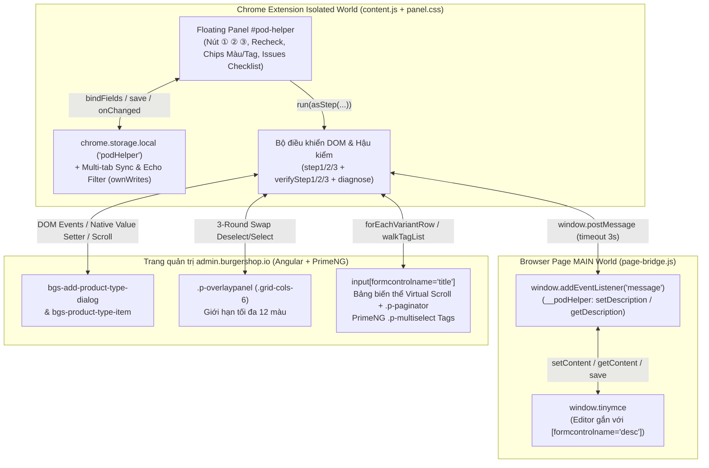

# Tài liệu Mã nguồn Chi tiết — BurgerShop POD Helper (`burgershop-pod-tool`)

> **Đường dẫn dự án:** `d:\Project\burgershop-pod-tool`
> **Loại ứng dụng:** Google Chrome Extension (Manifest V3 — Vanilla JavaScript + CSS Content Scripts)
> **Hệ thống đích:** Trang quản trị Print-on-Demand `https://admin.burgershop.io/*` (Angular Reactive Forms + PrimeNG + TinyMCE)

---

## 1. Tổng quan Dự án (Project Overview)

### 1.1. Bài toán thực tế & Đối tượng sử dụng
**BurgerShop POD Helper** là tiện ích mở rộng trình duyệt Chrome (Manifest V3) gắn một bảng điều khiển nổi (`#pod-helper`) trực tiếp lên trang quản trị `admin.burgershop.io`. Quy trình đăng một sản phẩm Print-on-Demand (POD) mới trên BurgerShop vốn gồm hàng chục thao tác lặp đi lặp lại dễ nhầm lẫn: mở hộp thoại tìm đúng phôi áo (ví dụ *Unisex T-Shirt | Comfort Colors 1717 (US)*), bật/tắt đúng bộ màu (bị giới hạn tối đa 12 màu và bảng biến thể dựng lại sau mỗi cú click), upload thiết kế, rồi sang màn hình chi tiết phải nhập Title, soạn Description trong TinyMCE, cuộn bảng biến thể ảo (virtual scroll / phân trang tới hàng trăm dòng) để sửa từng ô *Price* và *Compare price*, chọn hàng loạt *Tags* trong danh sách cuộn ảo PrimeNG và rà soát sai sót trước khi bấm *Save*.

Extension tự động hóa trọn vẹn 3 bước máy móc (① Chọn phôi áo, ② Chọn màu tối đa 12 màu, ③ Điền Title / Description / Giá toàn bộ biến thể / Tags), chừa lại đúng khâu sáng tạo duy nhất cho người dùng là **tự upload file design và bấm Save cuối cùng**, đồng thời tích hợp **bộ hậu kiểm tự động (`verifyStep1/2/3`)** gom mọi điểm lệch vào danh sách checklist **"⚠ Cần chỉnh tay"** ngay trên giao diện.

### 1.2. Tech Stack & Kiến trúc Nền tảng

| Thành phần | Công nghệ sử dụng | Chi tiết kỹ thuật |
| :--- | :--- | :--- |
| **Chuẩn Extension** | Chrome Extension Manifest V3 | Quyền `storage`, `host_permissions` giới hạn chặt ở `https://admin.burgershop.io/*` |
| **Isolated Content Script** | Vanilla JavaScript ES2020+ ([`content.js`](file:///d:/Project/burgershop-pod-tool/content.js)) | Dựng UI panel, lưu/đồng bộ cấu hình qua `chrome.storage.local`, điều khiển DOM Angular/PrimeNG |
| **Main-World Bridge** | Vanilla JavaScript ([`page-bridge.js`](file:///d:/Project/burgershop-pod-tool/page-bridge.js)) | Chạy ở `"world": "MAIN"` để truy cập biến toàn cục `window.tinymce` của trang web |
| **Giao diện Panel** | Scoped CSS ([`panel.css`](file:///d:/Project/burgershop-pod-tool/panel.css)) | Panel nổi cố định góc phải (`z-index: 2147483000`), kéo thả tự do, thu gọn được |
| **Tương thích Host App** | Angular (`formcontrolname`), PrimeNG (`.p-overlaypanel`, `.p-multiselect`, `.p-paginator`, `.p-scroller`), TinyMCE | Mô phỏng native setter, sự kiện `input`/`change`/`blur`, cuộn ảo (virtual scroll) và cách ly sự kiện chuột |

---

## 2. Kiến trúc Tổng thể & Luồng Dữ liệu (Architecture & Data Flow)

### 2.1. Sơ đồ Kiến trúc Hai Thế giới Thực thi (Dual-World Content Script Architecture)



### 2.2. Lý do Tách Hai Thế giới (`ISOLATED` vs `MAIN`)
- Trong Chrome Extension MV3, `content.js` chạy ở **Isolated World**: có quyền gọi `chrome.storage.local` nhưng **không nhìn thấy biến JS trên `window` của trang chủ** (như `window.tinymce`).
- Ngược lại, `page-bridge.js` được khai báo `"world": "MAIN"` trong `manifest.json`: chạy chung ngữ cảnh JS với Angular/TinyMCE của BurgerShop nên gọi thẳng được API `tinymce`, nhưng không có quyền gọi `chrome.*`.
- Hai bên giao tiếp bất đồng bộ qua `window.postMessage` với khóa định danh `__podHelper` (`setDescription` → `setDescriptionResult`, `getDescription` → `getDescriptionResult`) kèm timeout an toàn `3000ms`.

### 2.3. Quy trình Nghiệp vụ 3 Bước + Hậu kiểm Tự động
1. **Bước ① (`step1` → `verifyStep1`)**:
   - Từ trang *Products → All products*, tự tìm và bấm nút `"Create POD product"` (nếu hộp thoại chưa mở).
   - Chờ `<bgs-add-product-type-dialog>`, tìm thẻ sản phẩm có `span.truncate` khớp chính xác (không phân biệt hoa thường) với `cfg.productName`. Nếu chưa thấy trên danh sách đầu, tự gõ `cfg.searchKeyword` vào ô tìm kiếm của hộp thoại để lọc.
   - Tick chọn phôi áo (nếu chưa có icon `checkbox`), bấm nút `Save` ở chân hộp thoại, chờ `<bgs-product-type-item>` xuất hiện trong khung Design.
   - `verifyStep1()` kiểm tra lại: có đúng sản phẩm mục tiêu không, có bị dư nhiều hơn 1 loại áo không, hộp thoại đã đóng hẳn chưa.
   - Nếu tùy chọn `autoColors` (*"Chạy luôn ② sau ①"*, mặc định `true`) đang bật và Bước ① thành công → nghỉ `800ms` rồi tự động chạy luôn Bước ②.
2. **Bước ② (`step2` → `checkColors`)**:
   - Bấm nút `+` (`svg-icon[src*="plus"]`) trên `<bgs-product-type-item>` để mở `.p-overlaypanel` chứa lưới màu `.grid-cols-6`.
   - Giải bài toán giới hạn 12 màu & không cho bỏ màu cuối cùng của BurgerShop bằng **vòng lặp hoán đổi tối đa 3 lượt**:
     1. Bỏ bớt các màu đang chọn thừa (`deselectExtras`), giữ lại tối thiểu 1 màu để trang không chặn.
     2. Chọn thêm các màu nằm trong `cfg.colors` còn thiếu (nếu chạm trần 12 màu thì tạm nhường sang lượt kế tiếp).
     3. Bỏ nốt màu mặc định thừa còn sót sau khi đã có màu mục tiêu thay thế.
   - Kiểm tra đối chiếu danh sách màu thực tế với `cfg.colors` (`checkColors`), đóng bảng màu (`svg-icon[src*="times"]`) và nhắc người dùng upload design + bấm *Save*.
3. **Bước thủ công ở giữa**: Người dùng tải ảnh thiết kế lên khung Design và bấm *Save* để BurgerShop chuyển sang màn hình nhập thông tin sản phẩm.
4. **Bước ③ (`step3` → `verifyStep3`)**:
   - Điền `Title` vào `input[formcontrolname="title"]` bằng native setter + `blur`.
   - Chuyển `cfg.description` sang HTML (`textToHtml`) và gửi qua `page-bridge.js` nạp vào TinyMCE.
   - Duyệt toàn bộ bảng biến thể qua `forEachVariantRow` (tự cuộn khung cuộn ảo và tự bấm `.p-paginator-next` qua từng trang, quay lại `.p-paginator-first` khi xong) để điền cột *Price* và/hoặc *Compare price* (ô nào để trống trong panel sẽ giữ nguyên giá mặc định của trang).
   - Mở `.p-multiselect` của *Tags*, cuộn từ đầu đến cuối danh sách ảo để tick các tag khớp `cfg.tags`; với tag chưa xuất hiện do server-side lazy load, tự gõ tên tag vào ô lọc `.p-multiselect-filter` để tìm và chọn.
   - Chạy `verifyStep3()` soát lại từng trường (Title, nội dung text của Description, giá từng biến thể đối chiếu với tổng `x/400 Variants`, tag thiếu và tag thừa), tổng hợp ra khung `"⚠ Cần chỉnh tay"` rồi cuộn mượt lên đầu trang để người dùng kiểm tra và bấm *Save*.

---

## 3. Cấu trúc Thư mục & Bản đồ Toàn bộ Tệp nguồn (Complete File Map)

```text
burgershop-pod-tool/
├── manifest.json       # Khai báo Chrome Extension MV3, quyền hạn và 2 content scripts (MAIN + ISOLATED)
├── page-bridge.js      # Cầu nối chạy trong MAIN world để đọc/ghi TinyMCE editor của trang
├── content.js          # Toàn bộ logic tự động hóa 3 bước, hậu kiểm, đồng bộ cấu hình và UI panel
├── panel.css           # Định dạng giao diện panel nổi #pod-helper, trạng thái quay, danh sách lỗi & log
├── HUONG-DAN.md        # Tài liệu hướng dẫn cài đặt Load unpacked và cách vận hành nhanh cho người dùng
├── CODEBASE.md         # Tài liệu kiến trúc & tham chiếu mã nguồn chi tiết toàn diện (file này)
└── agent.md            # Quy trình đọc-hiểu và đồng bộ tài liệu bắt buộc cho AI Agent khi sửa code
```

| Tệp nguồn | Số dòng | Vai trò & Thành phần cốt lõi |
| :--- | :---: | :--- |
| [`manifest.json`](file:///d:/Project/burgershop-pod-tool/manifest.json) | 22 | Cấu hình MV3 v1.0.0, quyền `storage`, match `https://admin.burgershop.io/*`, nạp `page-bridge.js` (`MAIN`) & `content.js` + `panel.css` (`ISOLATED`) |
| [`page-bridge.js`](file:///d:/Project/burgershop-pod-tool/page-bridge.js) | 41 | Hàm `descEditor()` định vị đúng TinyMCE của `[formcontrolname="desc"]` và listener xử lý `setDescription` / `getDescription` |
| [`content.js`](file:///d:/Project/burgershop-pod-tool/content.js) | 1.091 | IIFE đóng gói toàn bộ biến cấu hình `cfg`, tiện ích DOM/scroll, `step1`/`step2`/`step3`, `verifyStep1/2/3`, `scanColors`/`scanTags`, `diagnose`, UI & drag-drop |
| [`panel.css`](file:///d:/Project/burgershop-pod-tool/panel.css) | 105 | Toàn bộ CSS cô lập dưới tiền tố `#pod-helper` để không xung đột style với trang quản trị BurgerShop |
| [`HUONG-DAN.md`](file:///d:/Project/burgershop-pod-tool/HUONG-DAN.md) | 33 | Hướng dẫn ngắn gọn cho người vận hành (cài đặt, bảng ý nghĩa nút ① ② ③, nút Chẩn đoán) |

---

## 4. Phân tích Chi tiết Từng Tệp & Hàm Mã nguồn (Deep-Dive Source Reference)

### 4.1. [`page-bridge.js`](file:///d:/Project/burgershop-pod-tool/page-bridge.js#L1-L41) — Cầu nối TinyMCE trong `MAIN` World
- **`descEditor()` (dòng 3–12)**:
  - Lấy mảng các editor từ `window.tinymce` (`tm.get ? tm.get() : tm.editors`).
  - Trang BurgerShop có **2 bộ soạn thảo TinyMCE** trên cùng form (`desc` cho *Description* và `short_desc` cho *Short Description*). Hàm tìm editor có `e.getElement().closest('[formcontrolname="desc"]')`, nếu không thấy mới fallback về `editors[0]`.
- **`message` Listener (dòng 14–41)**:
  - Chỉ nhận sự kiện từ chính `window` có `ev.data.__podHelper` là `'setDescription'` hoặc `'getDescription'`.
  - Khi `'setDescription'`: gọi `ed.setContent(ev.data.html)`, bắn sự kiện `'input'` và `'change'` qua `ed.dispatch` (TinyMCE 6+) hoặc `ed.fire` (TinyMCE 4/5), gọi `ed.save()` để đồng bộ ngược về `<textarea>` của Angular form.
  - Khi `'getDescription'`: gọi `ed.getContent({ format: 'text' })` để trả về chuỗi văn bản thuần phục vụ hậu kiểm `verifyStep3()`.

### 4.2. [`content.js`](file:///d:/Project/burgershop-pod-tool/content.js#L1-L1091) — Trái tim Tự động hóa & Giao diện Panel

#### A. Hằng số Mặc định & Đồng bộ Lưu trữ Đa Tab (Dòng 6–93, 1067–1090)
- **Chốt chặn nạp trùng (`window.__podHelperLoaded`, dòng 7–8)**: Đảm bảo script không gắn 2 panel nếu được inject lại.
- **`DEFAULT_COLORS` & `COLOR_LIMIT = 12` (dòng 11–20)**: Cài sẵn 39 màu chuẩn của dòng áo *Comfort Colors 1717* và trần tối đa 12 màu của BurgerShop.
- **Cơ chế chống ghi đè chéo giữa nhiều tab (`loaded` & `ownWrites`, dòng 86–92, 1067–1090)**:
  - Chỉ cho phép `save()` sau khi `chrome.storage.local.get('podHelper')` đã đọc xong (`loaded = true`).
  - Mỗi lần tab hiện tại lưu cấu hình, chuỗi `JSON.stringify(cfg)` được đưa vào tập `ownWrites`. Khi `chrome.storage.onChanged` nổ ra:
    - Nếu là "tiếng vọng" từ chính tab này (`ownWrites.delete(json)` trả `true`) → bỏ qua.
    - Nếu do tab `admin.burgershop.io` khác vừa sửa cấu hình → tự động cập nhật `cfg`, gọi `fillFields()`, `placePanel()`, `renderColors()`, `renderTags()`. Nhờ đó mở nhiều tab làm việc song song không bao giờ bị tab cũ ghi đè mất cấu hình mới!

#### B. Nhóm Hàm Tiện ích DOM & Tương tác Angular/PrimeNG (Dòng 41–83)
- `waitFor(fn, timeout = 15000, interval = 200)` (dòng 47–55): Polling hàm `fn()` mỗi `200ms` cho tới khi trả về giá trị truthy hoặc hết `timeout`.
- `scrollStep(el, step, wait = 150)` (dòng 59–66): Cuộn `el.scrollTop` xuống một đoạn `step`, bắn sự kiện `'scroll'`, chờ `wait` ms rồi kiểm tra `el.scrollTop > before + 1`. So sánh độ nhích thực tế giúp thoát vòng lặp ngay khi chạm đáy hoặc khi khung cuộn không thể nhích thêm (khắc phục triệt để lỗi treo vòng lặp vô ích).
- `setNativeValue(el, value)` (dòng 68–73): Gọi trực tiếp setter gốc `Object.getOwnPropertyDescriptor(HTMLInputElement.prototype, 'value').set` (hoặc `HTMLTextAreaElement.prototype`) rồi dispatch `'input'` và `'change'` có `bubbles: true` để vượt qua cơ chế theo dõi giá trị nội bộ của Angular / Zone.js.
- `textToHtml(text)` (dòng 75–82): Nếu người dùng nhập sẵn thẻ HTML (`/<\/?[a-z][\s\S]*>/i`) thì giữ nguyên; nếu nhập văn bản thuần thì escape HTML (`&`, `<`, `>`), tách đoạn theo dòng trống `\n{2,}` thành `<p>...</p>` và đổi xuống dòng đơn `\n` thành `<br>`.

#### C. Hệ thống Gom Lỗi theo Bước & Hậu kiểm (`asStep`, `issues`, `recheck`, dòng 97–139, 865–908)
- Biến `issues = { s1: null, s2: null, s3: null }` lưu kết quả kiểm tra riêng của từng bước (`null` = chưa chạy, `[]` = sạch lỗi, `[...]` = danh sách mục cần sửa tay).
- `asStep(step, fn)` (dòng 122–133): Đặt `currentStep = step`, xóa danh sách lỗi cũ của riêng bước đó, chạy `fn()`. Trong suốt thời gian `fn()` thực thi, mọi lời gọi `log(msg, 'err' | 'warn')` đều tự động đẩy `msg` vào `issues[currentStep]`!
- `recheck()` (dòng 901–908): Tự nhận diện màn hình đang mở để chạy lại bộ kiểm tra tương ứng:
  - Nếu trang đang có `input[formcontrolname="title"]` → chạy `verifyStep3()`.
  - Nếu trang đang ở khung Design (`findTypeItem('')`) → chạy liên tiếp `verifyStep1()` và `verifyStep2()`.

#### D. Chi tiết Bước ① — Chọn Phôi Áo (`step1`, `verifyStep1`, dòng 140–223)
- `typeDialog()` tìm phần tử custom element `<bgs-add-product-type-dialog>`.
- `findProductCard(name)` tìm `span.truncate` khớp tên và lấy thẻ cha `div.cursor-pointer`.
- Kiểm tra phôi áo đã được chọn sẵn hay chưa qua `card.querySelector('svg-icon[src*="checkbox"], img[src*="checkbox"]')` trước khi `card.click()` (tránh click nhầm thành bỏ chọn!).

#### E. Chi tiết Bước ② — Chọn Màu & Quét Màu (`step2`, `verifyStep2`, `scanColors`, dòng 225–376)
- `readColorOptions(panel)` (dòng 237–247): Đọc từng ô con trực tiếp `.grid-cols-6 > div`; một màu được coi là đang chọn (`selected = true`) khi vòng viền `div` con có class `'border-primary'`.
- `setColor(name, want)` (dòng 287–303): Bấm tối đa 3 lần; sau mỗi lần click chờ tối đa `2500ms` cho đến khi DOM phản ánh đúng `x.selected === want`, rồi chờ thêm `150ms` để BurgerShop dựng lại bảng biến thể xong mới sang màu kế tiếp.
- `scanColors()` (dòng 365–376): Mở bảng màu của phôi áo hiện tại, đọc toàn bộ danh sách tên màu thực tế lưu vào `cfg.availableColors`, lọc bỏ các màu đã chọn cũ không còn tồn tại trên phôi mới.

#### F. Chi tiết Bước ③ — Điền Biến thể Virtual Scroll & Tags (`step3`, `verifyStep3`, dòng 378–756)
- **`variantPriceRows()` (dòng 398–408)**: Tìm mọi hàng `<tr>` có từ 2 ô `input[type="number"][placeholder="$ 0.00"]` trở lên (`inputs[0]` là *Price*, `inputs[1]` là *Compare price*). Định danh duy nhất mỗi biến thể bằng `key` là tên biến thể chứa dấu `/` (ví dụ `".../Black/S"`).
- **`forEachVariantRow(fn, label)` (dòng 420–460)**:
  - Giữ tập `done = new Set()` lưu các `key` đã xử lý để không điền lặp khi virtual scroll tái sử dụng thẻ `<tr>`.
  - Tìm khung cuộn cha (`scrollParent`), cuộn từ `scrollTop = 0` xuống hết chiều cao theo từng bước `0.75 * clientHeight`.
  - Hỗ trợ cả trường hợp bảng phân trang bằng nút `.p-paginator-next` (tối đa 50 trang), sau khi duyệt hết tự động bấm `.p-paginator-first` để trả bảng về trang 1.
- **`configuredPrices(report)` (dòng 644–655)**: Chấp nhận cả dấu phẩy thập phân (đổi `,` thành `.`). Trả về `null` nếu ô để trống (giữ nguyên giá gốc trên trang), báo lỗi nếu nhập chữ không phải số.
- **`scanTags()`, `walkTagList()`, `selectTags()`, `readSelectedTags()` (dòng 534–680)**:
  - Làm việc với PrimeNG `.p-multiselect` và `.p-multiselect-panel` (cuộn trên `.p-scroller` hoặc `.p-multiselect-items-wrapper`).
  - Kết hợp thông minh 2 chiến lược: **quét cuộn tuần tự 1 lượt** (nhanh khi chọn nhiều tag) + **gõ lọc từng tag còn sót qua `.p-multiselect-filter`** (xử lý danh sách tag quá lớn chỉ tải từ server khi gõ tìm kiếm), sau đó xóa trắng ô lọc và đóng dropdown bằng cách click `document.body`.
- **`diagnose()` (dòng 759–786)**: Chụp nhanh 16 chỉ số trạng thái DOM hiện tại của trang `admin.burgershop.io` thành JSON và copy thẳng vào Clipboard để gửi cho AI Agent gỡ lỗi khi BurgerShop đổi giao diện.

#### G. Giao diện Kéo thả & Chặn Sự kiện Chuột (Dòng 789–1066)
- Kéo thả thanh tiêu đề `.pod-head`: dùng `window.addEventListener('mousemove' / 'mouseup', ..., true)` ở pha capture và kẹp tọa độ bằng `placePanel(left, top)` để panel không bao giờ bị kéo tụt ra ngoài mép cửa sổ trình duyệt, kể cả khi người dùng thu nhỏ cửa sổ (`window.addEventListener('resize', ...)`).
- **Dòng 1065 cực kỳ quan trọng**: `['mousedown', 'click'].forEach((t) => root.addEventListener(t, (e) => e.stopPropagation()))` — ngăn sự kiện click bên trong panel nổi lan ra `document`, tránh làm PrimeNG tự động đóng mất `.p-overlaypanel` hoặc `.p-multiselect-panel` đang mở!

---

## 5. Mô hình Dữ liệu Lưu trữ & Giao thức Nội bộ (Storage & Messaging Schema)

### 5.1. Cấu trúc `chrome.storage.local` (Key: `podHelper`)

| Trường (`cfg.*`) | Kiểu dữ liệu | Mặc định | Ý nghĩa |
| :--- | :--- | :--- | :--- |
| `productName` | `string` | `'Unisex T-Shirt \| Comfort Colors 1717 (US)'` | Tên đầy đủ của phôi sản phẩm cần chọn ở Bước ① |
| `searchKeyword` | `string` | `'comfort colors 1717'` | Từ khóa gõ vào ô tìm kiếm hộp thoại nếu không thấy ngay trên đầu |
| `availableColors` | `string[]` | 39 màu Comfort Colors 1717 | Danh sách chip màu hiển thị trong phần cấu hình Màu |
| `colors` | `string[]` | `[]` | Các màu đang được tick chọn để áp dụng ở Bước ② (tối đa `12`) |
| `autoColors` | `boolean` | `true` | Tự động chạy Bước ② ngay sau khi Bước ① hoàn tất |
| `title` | `string` | `''` | Tiêu đề sản phẩm điền ở Bước ③ |
| `description` | `string` | `''` | Mô tả sản phẩm (text thuần hoặc HTML) điền vào TinyMCE ở Bước ③ |
| `price` | `string` | `''` | Giá bán áp cho mọi biến thể (`''` = giữ nguyên cột Price của trang) |
| `comparePrice` | `string` | `''` | Giá gốc so sánh áp cho mọi biến thể (`''` = giữ nguyên cột Compare price) |
| `availableTags` | `string[]` | `[]` | Danh sách tag đã quét từ trang để hiển thị thành chip |
| `tags` | `string[]` | `[]` | Các tag cần gắn cho sản phẩm ở Bước ③ |
| `collapsed` | `boolean` | `false` | Trạng thái thu gọn hay mở rộng của panel `#pod-helper` |
| `pos` | `{left: number, top: number} \| null` | `null` | Vị trí tọa độ pixel nếu người dùng đã kéo panel sang chỗ khác |

### 5.2. Giao thức `window.postMessage` giữa `content.js` và `page-bridge.js`
- **Yêu cầu ghi mô tả:** `{ __podHelper: 'setDescription', html: '<p>...</p>' }` → Phản hồi: `{ __podHelper: 'setDescriptionResult', ok: boolean, detail: string, text: '' }`.
- **Yêu cầu đọc mô tả để kiểm tra:** `{ __podHelper: 'getDescription' }` → Phản hồi: `{ __podHelper: 'getDescriptionResult', ok: boolean, detail: string, text: string }`.

---

## 6. Giao diện Panel & Hệ thống Thiết kế (`panel.css`)

- **Vị trí & Kích thước:** `position: fixed; top: 80px; right: 16px; width: 330px; max-height: calc(100vh - 100px); z-index: 2147483000`.
- **Màu sắc chủ đạo:** Xanh lam đậm `#1d4ed8` (header, nút chính `.primary`, chip đang chọn `.pod-chip.on`), nền trắng `#fff`, chữ chính `#1f2937`.
- **Trạng thái trực quan:**
  - Đang chạy (`.busy`): khóa click các nút hành động (`pointer-events: none; opacity: 0.55`), tự bung khung `Log chi tiết` và hiện thanh `.pod-status` kèm vòng xoay `@keyframes pod-spin`.
  - Khi chạy xong: tự đóng `Log chi tiết` để gọn màn hình, chỉ giữ lại hộp kết quả hậu kiểm `.pod-issues` (nền xanh ngọc `#ecfdf5` nếu khớp 100%, hoặc nền đỏ nhạt `#fef2f2` kèm checkbox gạch ngang `line-through` cho từng lỗi cần chỉnh tay).

---

## 7. Hướng dẫn Cài đặt, Chạy thử & Gỡ lỗi (Setup & Debugging)

### 7.1. Cài đặt vào Google Chrome / Edge / Brave
1. Mở trình duyệt, truy cập `chrome://extensions`.
2. Bật công tắc **Developer mode** ở góc trên bên phải.
3. Nhấn **Load unpacked** và trỏ tới thư mục **`d:\Project\burgershop-pod-tool`**.
4. Mở hoặc tải lại (`F5`) trang `https://admin.burgershop.io` → Panel **POD Helper** sẽ xuất hiện ở góc phải màn hình.

### 7.2. Quy trình Sau Khi Sửa Mã nguồn
- Mỗi khi sửa `manifest.json`, `content.js`, `page-bridge.js` hoặc `panel.css`:
  1. Vào `chrome://extensions` bấm biểu tượng **Reload (⟳)** trên thẻ *BurgerShop POD Helper*.
  2. Quay lại tab `admin.burgershop.io` bấm **`F5`** để nạp lại cả `MAIN` world lẫn `ISOLATED` world.
- Khi có bước không hoạt động do BurgerShop cập nhật giao diện: mở mục **Log chi tiết** ở cuối panel → bấm **Chẩn đoán** → JSON cấu trúc trang sẽ tự động copy vào Clipboard để phân tích.

---

## 8. Quy ước, Bất biến Kỹ thuật & Các Điểm Dễ Lỗi (Invariants & Gotchas)

1. **Bất biến chặn nổi bọt sự kiện (`stopPropagation`) trên `#pod-helper`:**
   - Dòng `1065` của `content.js` chặn `mousedown` và `click` nổi bọt lên `document`. Nếu xóa dòng này, mỗi lần người dùng bấm nút trong panel khi bảng màu (`.p-overlaypanel`) hoặc bảng tag (`.p-multiselect-panel`) của PrimeNG đang mở, PrimeNG sẽ tưởng người dùng click ra ngoài và đóng sập bảng ngay lập tức.
2. **Bất biến cô lập CSS bằng `#pod-helper`:**
   - `panel.css` được chèn thẳng vào trang `admin.burgershop.io` (không dùng Shadow DOM). Vì vậy **mọi selector trong `panel.css` bắt buộc phải bắt đầu bằng `#pod-helper`** để không làm hỏng giao diện Angular/PrimeNG của trang gốc.
3. **Bất biến 12 màu & Màu cuối cùng của BurgerShop:**
   - Trang BurgerShop không cho phép bỏ chọn khi chỉ còn 1 màu duy nhất và từ chối chọn thêm khi đã đủ 12 màu. Không được thay thuật toán 3 vòng lặp trong `step2()` bằng vòng lặp tuần tự đơn giản *"bỏ hết rồi chọn lại"* vì sẽ kẹt ở màu thứ 12!
4. **Bất biến Virtual Scroll của Bảng Biến thể & Danh sách Tag:**
   - Các hàng `<tr>` trong bảng giá biến thể bị hủy/tạo lại liên tục khi cuộn. Luôn định danh biến thể qua chuỗi tên `row.key` (`".../Black/S"`), tuyệt đối không lưu tham chiếu phần tử DOM `<tr>` qua các bước cuộn.
5. **Chi tiết nhỏ trong `HUONG-DAN.md`:**
   - Dòng 9 của `HUONG-DAN.md` hiện vẫn ghi đường dẫn cũ lúc mới phát triển là `D:\Project\Searching\burgershop-pod-tool`, trong khi thư mục thực tế hiện tại đã chuyển ra `d:\Project\burgershop-pod-tool`.

---

## 9. Nhật ký Cập nhật Tài liệu (Documentation Changelog)

| Ngày | Người / Agent thực hiện | Nội dung cập nhật |
| :--- | :--- | :--- |
| 2026-10-26 | Antigravity Agent | Khởi tạo tài liệu `CODEBASE.md` chi tiết toàn diện sau khi đọc 100% toàn bộ 5 tệp nguồn của dự án. |
