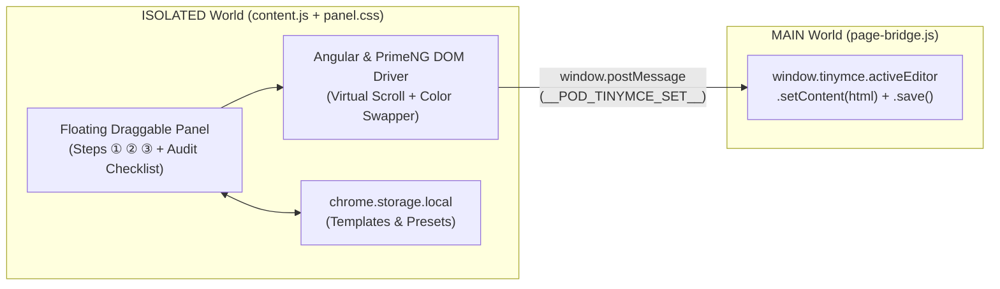

# BurgerShop POD Helper — Chrome Extension (Manifest V3) for E-Commerce Admin Automation

  

    
    
    
  

---

## ⚡ Overview

**BurgerShop POD Helper** is a Manifest V3 Google Chrome Extension that injects a floating automation control panel (`#pod-helper`) into the `admin.burgershop.io` Print-on-Demand (POD) portal (built on **Angular Reactive Forms**, **PrimeNG** virtual-scroll components, and **TinyMCE**).

Creating a single multi-variant POD product listing manually requires dozens of repetitive clicks across re-rendering variant tables and virtual-scroll dropdowns. This extension automates the entire 3-step pipeline while running a post-execution verification audit (`verifyStep1/2/3`).

---

## 🏗️ Dual-World Content Script Architecture

Because Chrome Extension content scripts run in an `ISOLATED` JavaScript world and cannot directly call `window.tinymce` on the host page, the extension uses a clean **Dual-World Bridge**:

### Key Engineering Solutions
1. **3-Round Color Swap Algorithm (12-Color Hard Cap Bypass):** The host portal blocks selecting a 13th color swatch (`max = 12`). The extension executes a 3-round state reconciliation loop—deselecting unwanted default colors first (`Round 1`), selecting missing target colors (`Round 2`), and verifying final swatch state (`Round 3`)—while waiting for PrimeNG to finish re-rendering the variant table after each click.
2. **PrimeNG Virtual-Scroll Variant Pricing (`forEachVariantRow`):** Variant tables with 100+ rows reuse DOM `<tr>` nodes as the user scrolls. The automation scrolls incrementally through `.p-scroller`, tracks processed variants by normalized key (`Product / Color / Size`), invokes native `HTMLInputElement.prototype.value` setters, and dispatches `input` / `change` / `blur` events so Angular's `FormControl` state commits properly.
3. **Automated Post-Flight Verification (`verifyStep1/2/3`):** Audits the live DOM after every step and surfaces any discrepancies in an interactive **"⚠ Needs Attention"** checklist.

---

## 🚀 Installation (Developer Mode)

1. Open `chrome://extensions/` in Google Chrome.
2. Enable **Developer mode** (top-right toggle).
3. Click **Load unpacked** and select this repository folder (`burgershop-pod-tool`).
4. Navigate to `https://admin.burgershop.io/` — the `#pod-helper` floating panel will appear in the bottom-right corner.

---

## 📂 Repository Files

| File | Role |
| :--- | :--- |
| [`manifest.json`](manifest.json) | Manifest V3 declaration (`ISOLATED` + `MAIN` world content scripts, `storage` permission) |
| [`content.js`](content.js) | UI panel, preset storage, 3-step Angular/PrimeNG automation engine & `verifyStep1/2/3` auditor |
| [`page-bridge.js`](page-bridge.js) | `MAIN` world bridge communicating with `window.tinymce` via `window.postMessage` |
| [`panel.css`](panel.css) | Scoped styles for the draggable floating control panel |

---

**Author:** **Trung Thanh Tran** (*Trần Trung Thành*) · [GitHub `@Tthanh2k6`](https://github.com/Tthanh2k6) · [Upwork Profile](https://www.upwork.com/freelancers/~01ee7c2348cb4b62fe)
